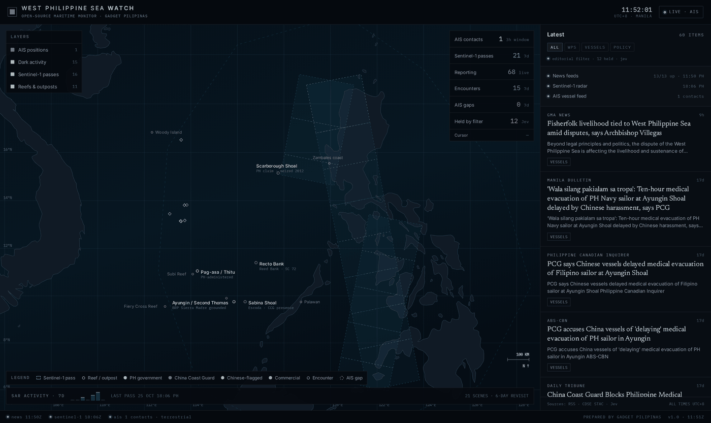

# West Philippine Sea Watch

A public, open-source monitor of the West Philippine Sea: sourced geography, live vessel
activity, Sentinel-1 radar passes, and Philippine-interest reporting filtered by a decision
model.

**Live:** https://wps.gdgt.link · Published by [Gadget Pilipinas](https://gadgetpilipinas.net)



## What it does

1. **Ingests** 13 allowlisted RSS/Atom feeds every 5 minutes, keeping only items that
   mention the sea, its features, the actors, or the policy fight (30 keywords).
2. **Gates** each surviving item through Jev, a typed decision model, on two axes: does
   this serve a Philippine reader, and does it carry PRC state framing. Items that fail
   are held, and the UI reports how many.
3. **Pulls** Sentinel-1 scene geometry from the Copernicus Data Space STAC API (7-day
   window) and draws each pass as a footprint, so "when was this water last imaged" is a
   question you can answer by looking.
4. **Subscribes** to AISStream for live hull reports inside the WPS box, classifies them
   conservatively, and keeps a bounded picture with short trails.
5. **Queries** Global Fishing Watch for AIS-gap and encounter events inside the same box,
   filtering out physically impossible "gaps" before plotting them.
6. **Serves** one self-contained HTML file plus a small JSON API from a loopback-only
   Python server, published through a Cloudflare Tunnel.

The map is inline SVG built from Natural Earth geometry. There are no map tiles, no map
SDK, and no third-party runtime dependency, so the surface works offline except for the
data APIs it is explicitly watching.

## Data layers, and what each one cannot tell you

| Layer | Source | Freshness | Limitation |
|---|---|---|---|
| Reporting | 13 RSS/Atom feeds | 5 min | Google News aggregation supplies volume; publisher name can lag the outlet |
| Radar passes | Copernicus Data Space STAC (`sentinel-1-grd`) | 30 min poll, ~6-day revisit | Geometry only. No ship detection is run on the scenes |
| Vessel positions | AISStream WebSocket | streaming, 3-hour staleness window | **Terrestrial receivers only.** Measured 0-1 contacts per 35 s offshore in the WPS vs 6 in the Singapore Strait |
| Encounters / AIS gaps | Global Fishing Watch v3 events | 10 min poll, 7-day window | Detections lag; gap payloads contain AIS junk that must be filtered |
| Features | Static, inlined | build time | Curated coordinates and names, not a legal boundary |

Contested or approximate shapes are drawn dashed. No line is rendered as if it were
sourced data.

### Class labels are a factual claim, so they are narrow

- `ccg` — only hulls whose AIS name says HAI JING or CCG
- `ph` — MMSI 548 or BRP-named hulls
- `cn` — any Chinese-flagged MMSI (412/413), which includes fishing hulls
- `com` — everything else

Chinese fishing hulls are **not** labelled "maritime militia". AIS alone cannot establish
that, and a public dashboard should not imply it.

## Editorial filter (Jev)

`jev_gate.py` sends four typed questions per item and enforces the answers.

| Question | Type | Meaning |
|---|---|---|
| `ph_interest` | noul | Does a Philippine reader need this to understand their own maritime situation? |
| `prc_narrative` | noul | Does it carry PRC state framing into the reader's head? |
| `attribution` | score (3) | How independent is the sourcing? |
| `local_value` | score (3) | How directly does it affect Filipinos? |

Keep rule: `ph_interest >= 0.45` **and** `prc_narrative <= 0.55`.

Static rules run ahead of the model: a 12-domain denylist (Xinhua, Global Times, CGTN,
China Daily, People's Daily, China.org, news.cn, SCMP and similar), a social-share
publisher deny (Facebook, X, YouTube, TikTok, Reddit and friends), keyword relevance,
title-hash dedupe across aggregators, and a 21-day age cap.

Properties that matter:

- **Fail-open.** If Jev is disabled, capped, slow, or erroring, allowlisted items stay
  visible and `/api/summary` reports `filter_state: degraded`. A filter outage can never
  empty the rail silently.
- **Cached verdicts.** Verdicts are keyed by schema version plus item id and stored for 7
  days, so only new items cost a call. A full 80-item pass costs about $0.0016 at roughly
  $0.00003 per item.
- **Bounded.** 90 items and 150 seconds per cycle, $0.60/day cap, logged through the
  shared Jev log with `caller=wps_watch`.
- **Tuned on real items, not vibes.** The wording was A/B'd against the same 40 stored
  items: the first version wrongly held a Philippine church statement (0.23) and wrongly
  kept a gas-asset business story (0.63). After tightening the criteria those score 0.86
  and 0.24, and the ambiguous 0.35-0.45 band went from 2 items to 0.

## Architecture

```
browser ──TLS──> Cloudflare edge ──tunnel──> 127.0.0.1:8931
                                             server.py (stdlib http.server)
                                               ├── site/index.html   one file, inline SVG + CSS
                                               ├── /api/news         RSS → Jev gate → rail
                                               ├── /api/sar          CDSE STAC → footprints
                                               ├── /api/vessels      AISStream worker snapshot
                                               ├── /api/events       GFW gaps + encounters
                                               └── /api/summary      feed health, counters, filter state
```

The server exists for three reasons: it holds the feed keys (the browser never sees them),
it caches upstream calls so the page is cheap, and it can set headers a static host cannot.

| File | Role |
|---|---|
| `server.py` | HTTP server, routes, security headers, rate limit, refresh loop |
| `ingest.py` | RSS/Atom parsing, Copernicus STAC, Global Fishing Watch v3 |
| `ais.py` | AISStream WebSocket worker, classification, bounded snapshot |
| `jev_gate.py` | Jev questions, gating, verdict cache, logging |
| `build.py` | Inlines geometry, self-hosts fonts, emits CSP hashes |
| `qa.py` | Measurement QA against a live URL |
| `watchdog.sh` | Restart-on-unhealthy, driven by an external scheduler |
| `site/template.html` | Dashboard source (CSS, SVG map, label solver, rail) |
| `land.json` | Natural Earth 50m geometry, simplified and rounded for SE Asia (~93 KB) |

## API

All endpoints are `GET`/`HEAD` only; anything else returns `405`.

| Route | Returns |
|---|---|
| `/` | The dashboard (single HTML document) |
| `/api/summary` | Feed health, counters, filter state, last refresh times |
| `/api/news?filter=all\|wps\|vessels\|policy` | Gated items: `title`, `summary`, `publisher`, `published`, `tag`, `link` |
| `/api/sar` | Up to 16 recent scene footprints with acquisition time, platform, orbit |
| `/api/vessels` | AIS snapshot: `id`, `cls`, `type`, `pos`, `hdg`, `spd`, `seen`, `trk` |
| `/api/events` | `gaps` and `encounters` with positions, vessels, flags, timestamps |
| `/api/health` | `{"ok": true}` plus server time |
| `/robots.txt` | Crawl policy |

JSON responses carry `Cache-Control: no-store`; assets are immutable for a year.

## Security model

- Origin binds **127.0.0.1 only**. The only public path is a proxied Cloudflare Tunnel
  hostname, so the origin IP is never exposed and there is no port to scan.
- **CSP** `default-src 'none'`, `script-src 'self'` plus one sha256 hash of the inline
  script plus Cloudflare's own analytics origin. Inline styles need
  `style-src 'unsafe-inline'` because the markup uses style attributes; scripts do not.
  `base-uri 'none'`, `form-action 'none'`, `frame-ancestors 'none'`.
- **HSTS** one year, `X-Frame-Options: DENY`, `X-Content-Type-Options: nosniff`,
  `Referrer-Policy: no-referrer`, COOP/CORP `same-origin`, restrictive
  `Permissions-Policy`.
- Plaintext requests are redirected to HTTPS at the origin when `X-Forwarded-Proto: http`.
- **120 requests/minute/IP** token bucket with `429` and `Retry-After`, 512-byte URL cap,
  static path allowlist with realpath containment, dotfile and extension deny, no
  directory listing, no `Server` banner, JSON errors only.
- No user-supplied URL is ever fetched. Outbound calls are fixed, allowlisted, size-capped
  (3 MB) and timeout-bounded (15-45 s).
- Keys live in an env file outside the repository (mode `0600`) and are read server-side.

Verified over the public hostname: 405 on write methods, 404 on traversal and dotfile
probes, 301 on plaintext, 429 after the rate limit, zero console errors, and a CSP hash
that survives a rebuild because the server re-reads it by mtime.

## Configuration

Environment (outside the repo, never committed):

| Variable | Required | Purpose |
|---|---|---|
| `OPENROUTER_API_KEY` | yes | Jev decision calls |
| `AISSTREAM_KEY` | for the vessel layer | Free key from https://aisstream.io |
| `GFW_TOKEN` | for the event layer | Free token from https://globalfishingwatch.org/our-apis/tokens |
| `JEV_DISABLED` | optional | `1` disables the filter (it then fails open) |

`config.json` holds everything tunable:

| Key | Default | Meaning |
|---|---|---|
| `bbox` | `[112, 5, 121.5, 19]` | The WPS box, lon/lat order |
| `news.ttl_s` | `300` | Feed refresh interval |
| `news.max_items` | `80` | Items kept per cycle |
| `news.max_age_days` | `21` | Age cap |
| `news.jev.ph_min` | `0.45` | Minimum Philippine-interest probability |
| `news.jev.prc_max` | `0.55` | Maximum PRC-narrative probability |
| `news.jev.enforce` | `true` | `false` scores but shows everything (shadow mode) |
| `news.jev.cost_cap_usd` | `0.60` | Daily Jev spend cap |
| `feeds[]` | 13 feeds | Allowlisted sources |
| `deny_domains[]` | 12 domains | Publisher-level denylist |

## Local setup

```bash
git clone <this repo> && cd wps-watch
python3 build.py                 # inline geometry, fetch latin font subsets, hash the CSP
python3 server.py                # http://127.0.0.1:8931
LD_LIBRARY_PATH=/data/chromium-libs/all python3 qa.py http://127.0.0.1:8931/
```

Requires Python 3.11+ and `websockets` (`pip install websockets`) for the AIS worker.
Playwright plus Chromium is needed only for `qa.py`.

`build.py` is idempotent: run it after editing `site/template.html` or `land.json`. It
rewrites `site/index.html` and `csp.json`; the server picks up new hashes without a
restart.

## Deployment

Two independent moves:

1. **Rebuild only** — `python3 build.py`. No restart. Use for template, geometry or font
   changes.
2. **Restart required** — anything in `*.py`, `config.json`, or the env file. Stop the
   origin and let the watchdog bring it back, or start it by hand.

Point a tunnel route for the hostname at `http://127.0.0.1:8931`, keep the origin on
loopback, and let the edge terminate TLS. Day-to-day operations, restart procedure and log
locations: [docs/OPERATIONS.md](docs/OPERATIONS.md).

## Design notes

The layout was locked from an approved peg ([docs/design-peg.png](docs/design-peg.png))
before any data was wired:

- three zones: a 58px command bar, the sea, a 404px editorial rail
- Inter for chrome, IBM Plex Mono for anything measured (coordinates, times, counts), a
  serif (Newsreader) for headlines, because a newsroom rail should read like one
- one hue per entity class, reused everywhere, never decoration
- structure with hairlines, not cards; no glassmorphism, no gradient blobs, no icon soup
- labels are placed by a greedy four-position solver with an occupancy list, so the
  Ayungin/Sabina cluster stays readable instead of being hand-nudged
- synthetic data was deleted, not dressed up: the build shows real feeds, real radar
  passes, real events, and says "idle" where a layer genuinely has nothing

## Limitations

- **AIS coverage offshore is thin.** A receiver problem, not a code problem. A dense WPS
  picture needs satellite AIS or a radar-detection layer.
- **No ship detection on the radar scenes.** Footprints answer "when was this imaged", not
  "what is there". GFW's SAR vessel detections (a 4Wings dataset, ~5-day lag) would close
  that gap.
- **No incident log yet.** There is no curated WPS incident feed wired in; the peg's
  incident layer was removed rather than faked.
- **English-language sources only**, and the filter reads headlines plus summaries, not
  full article text.

## Ownership

Proprietary. Built and operated by Gadget Pilipinas. Contact the editor for reuse.
